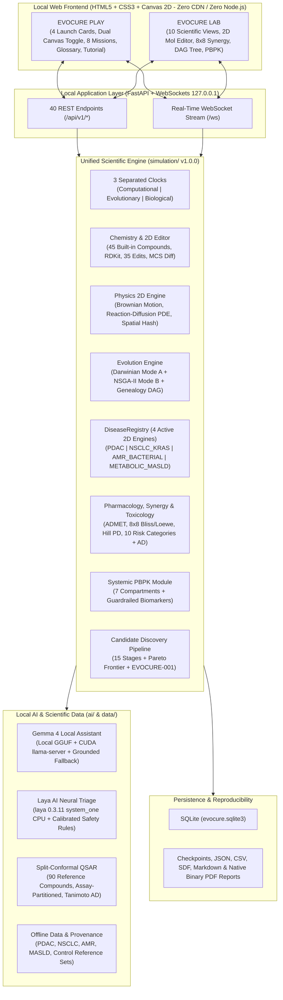

# Architecture Document - EVOCURE & EVOCURE PLAY

**Project:** EVOCURE (*Evolutionary Chemical Universe & Cancer Research Engine*) + **EVOCURE PLAY**  
**Version:** `1.0.0`  
**Execution Policy:** 100% Local, Isolated inside `.venv` (Python 3.12), Offline-First, Zero Cloud/Remote API Runtime Dependency

---

## 1. Architectural Vision & Core Invariants

**EVOCURE** is a local interactive computational research platform combining two complementary scientific simulation regimes inside a single deterministic, auditable engine:

1. **2D Evolutionary Chemical Universe**:
   - **Mode A (`ARTIFICIAL_LIFE`)**: Artificial chemical life ecosystem (self-replicating templates/protocells, substrate consumption, catalysis, autocatalysis, competition, cooperation, parasitism, spatial niches, environmental shifts, and stochastic drift). Explicitly labeled as a computational abstraction.
   - **Mode B (`GROUNDED_CHEMISTRY`)**: Grounded computational chemistry with strict **RDKit** structural sanitization, atomic & formal-charge conservation across elementary transformations, interactive **2D Molecular Structure Editor** (35 valence-validated transformations + MCS Coral/Cyan structural diffs), exact physicochemical descriptors, Bemis-Murcko scaffold families, and **NSGA-II** multi-objective evolutionary optimization.
2. **Extensible Multi-Disease Biomedical & Oncology Engine (4 Active 2D Mechanistic Engines)**:
   - **`PDAC` - Pancreatic Ductal Adenocarcinoma** (*Inaugural Reference Module*): Subclonal heterogeneity (`KRAS`, `TP53`, `CDKN2A`, `SMAD4`), desmoplastic stroma (CAFs/ECM diffusion barrier), vascular supply, spatial reaction-diffusion PDEs for $\text{O}_2$, nutrients, and drug candidates, hypoxic/necrotic cores, apoptosis, clonal resistance selection, and drug-tumor coevolution.
   - **`NSCLC_KRAS` - KRAS-Mutant Lung Adenocarcinoma**: High-perfusion alveolar capillary bed, `KRAS-G12C` sensitive vs. `MET`-amplified persister clones, and healthy AT2 pneumocytes.
   - **`AMR_BACTERIAL` - Carbapenem-Resistant *A. baumannii* Biofilm**: Extracellular polymeric substance (EPS) diffusion barrier, Monod bacterial growth kinetics, `KPC` carbapenemase enzymatic drug hydrolysis, and $\beta$-lactamase inhibitor protection synergy.
   - **`METABOLIC_MASLD` - Metabolic Steatohepatitis**: Hepatic lobule Zone 1-3 oxygen/lipid gradients, steatotic hepatocyte lipotoxicity, activated hepatic stellate cell (HSC) collagen fibrosis, and APAP hepatotoxicity response.
   - **2-Drug Combination Pharmacology & 4-Arm Trials**: Coupled dual-compound reaction-diffusion PDEs with `8x8` Bliss Independence & Loewe Combination Index matrices across all 4 disease engines.
   - **7-Compartment Systemic PBPK/PK-PD Module**: Blood, Liver, Kidneys, Bone Marrow, Pancreas, Tumor, and Peripheral tissues strictly separated from local 2D slice metrics.

### Strict Separation Between Core Scientific Simulation & Multi-Provider AI Copilot
- During engineering/development, the Chief Orchestrator coordinates specialized Flash agents (`Chemistry`, `Physics`, `Evolution`, `Cancer Biology`, `Pharmacology`, `Toxicology`, `AI/ML`, `Simulation`, `Godot World`, `Godot UI`, `Validation`), each producing verifiable code, contracts, tests, and technical reports.
- At runtime (`python run.py`), **100% of mathematical, chemical, cellular, QSAR, and Laya neural triage calculations run strictly locally inside `.venv` with zero cloud dependency**.
- For natural-language scientific interpretation (`EVOCURE Research Assistant`), the **default provider (`auto_local`) is 100% offline** via local **Gemma 4** (`Gemma-4-E2B-Heretic-Q4_K_M.gguf` + CUDA `llama-server.exe`) and the deterministic grounded engine. Users may optionally configure **Google Gemini** (`gemini`) or **OpenAI** (`openai`) via the masked UI modal or `.env`; every provider receives the exact same grounded simulation telemetry and obeys strict non-clinical epistemic guardrails (`EpistemicCategory.AI_HYPOTHESIS`).

### Native Godot 4.7 Desktop Frontend + Web Dual Architecture
- **Primary Visual Client (`godot_frontend/`)**: Hardware-accelerated **Godot 4.7** 2D scientific client featuring custom GLSL microenvironment caustic and bioluminescent aura shaders, 16 `256x256` RGBA chemical creature & biological cell sprites, modular phenotypic rig (`CreatureRig2D.gd`), native RDKit SVG-to-`ImageTexture` rasterization, real-time WebSocket streaming (`/ws`), and 6 workspaces seamlessly toggling between `Lab Mode` and `Play / Battle Mode`.
- **Fallback Web Client (`frontend/`)**: Zero-CDN, zero-Node.js HTML5 + Canvas workbench served at `http://127.0.0.1:8000` over the exact same FastAPI & WebSocket state stream.

---

## 2. Modular Architecture Diagram

---

## 3. Host Hardware Profile & `.venv` Encapsulation Boundaries

### Inspected Host Hardware
- **OS**: Windows 10/11 x64 (`10.0.26200`)
- **CPU**: AMD Ryzen 5 3600X (6 physical cores / 12 logical threads)
- **RAM**: 31.92 GB DDR4
- **GPU**: NVIDIA GeForce RTX 3060 (12 GB VRAM, Driver `596.49`)
- **Isolated `.venv` Interpreter**: CPython `3.12.13` at `EVOCURE/.venv`

### Components Outside `.venv` (Mandatory Disclosure - Section 2.14)
By operating-system design, the following components **cannot be encapsulated inside a Python `.venv`**:
1. Operating System Kernel (Windows / Linux / macOS).
2. Native GPU Kernel/Display Drivers (e.g., NVIDIA Driver `596.49` / CUDA Driver API).
3. Local Web Browser rendering the HTML5/Canvas interface (`Edge`, `Chrome`, `Firefox`, or `Safari`).
4. Base host Python binary used once during initial `.venv` bootstrap.

All Python libraries (`numpy`, `scipy`, `rdkit`, `scikit-learn`, `torch`, `transformers`, `laya`, `fpdf2`, `fastapi`, `uvicorn`, `psutil`, `pytest`) reside strictly inside `EVOCURE/.venv`.
