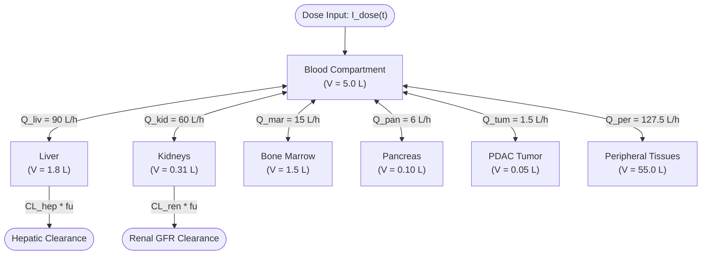

# Technical Report: Pharmacology, Toxicology, 7-Compartment Systemic PBPK, and Biological Indicators Modules

**Agent Role:** EVOCURE Pharmacology & Toxicology Agent  
**Host Architecture:** Windows x64 | CPython 3.12.13 (`.venv`)  
**Specification Version:** `0.1.0`  
**Date:** October 2026  
**Status:** Validated & Integrated  

---

## 1. Executive Summary & Epistemic Boundaries

This report documents the architectural design, mathematical foundations, and implementation details for the **Pharmacology**, **Toxicology**, **7-Compartment Systemic PBPK**, and **Biological Indicators** modules of EVOCURE.

All modules adhere strictly to the typing, provenance, and epistemic classification standards established in `simulation/core/contracts.py`:
- **Epistemic Transparency**: Every computed property, toxicity category, and biomarker is wrapped in `ScientificValue` with explicit category tags, numerical confidence, uncertainty intervals, provenance, and limitations.
- **Exposure Tripartite Partitioning**: Strict differentiation between total applied concentration ($C_{\text{applied}}$), free unbound extracellular concentration ($C_{\text{free}} = f_u \cdot C_{\text{applied}}$), and effective intracellular concentration ($C_{\text{intra}}$).
- **Mode A / Mode B Epistemic Wall (Section 5.1)**: Under `validate_for_biomedical_mode`, artificial life fitness traits from `ARTIFICIAL_LIFE` (Mode A) are permanently discarded and never transferred into biomedical potency. Grounded chemical validity via RDKit is strictly mandated.
- **Systemic PBPK Decoupling Guardrail (Section 12)**: When systemic PBPK is disabled (`systemic_pbpk_result is None` in 2D tumor-only mode), all hematological and systemic metabolic/organ lab values are strictly marked `value=None` with `EpistemicCategory.UNMODELED` (`"Not modeled"`). Fabricating systemic patient lab values from a 2D spatial slice is strictly prohibited.
- **Safety Precaution**: The engine operates purely as an in silico research and exploratory ranking system. All outputs include explicit disclaimers: human clinical doses, treatment regimens, or clinical diagnostic claims are never emitted.

---

## 2. Directory Layout & Module Deliverables

The implemented files are organized as follows:

```
e:\MA\EVOCURE\
├── simulation\
│   ├── pharmacology\
│   │   ├── __init__.py           # Exports PharmacologyEngine, validate_for_biomedical_mode
│   │   └── admet.py              # ADMET physicochemical properties, Hill PD, exposure partition
│   ├── toxicity\
│   │   ├── __init__.py           # Exports ToxicologyEngine
│   │   └── models.py             # SMARTS alert screener, 10 risk categories, risk index (0-100)
│   └── systemic\
│       ├── __init__.py           # Exports SystemicPBPKEngine, BiologicalIndicatorsEngine
│       ├── pbpk.py               # 7-compartment mass-balance ODE solver (scipy.integrate.solve_ivp)
│       └── biomarkers.py         # Multimodal biomarker panels with strict UNMODELED guardrail
└── docs\
    └── agents\
        └── pharmacology_toxicity_report.md  # This technical report
```

---

## 3. ADMET & Physicochemical Engine (`PharmacologyEngine`)

### 3.1. Governing Physicochemical Formulations

1. **Molecular Weight ($MW$) & Wildman-Crippen Lipophilicity ($\text{cLogP}$)**:
   Computed using RDKit's topological and atomic contribution algorithms (`Descriptors.MolWt` and `Crippen.MolLogP`).

2. **Distribution Coefficient ($\text{LogD}_{7.4}$)**:
   Physiological pH 7.4 ionization adjustment based on the Henderson-Hasselbalch relation:
   $$\text{LogD}_{7.4} = \text{LogP} - 1.15 \cdot |Q_{\text{formal}}|$$

3. **ESOL Aqueous Solubility ($\log S$, mol/L)**:
   Implemented using Delaney's validated quantitative structure-property relationship (2004):
   $$\log S = 0.16 - 0.63 \cdot \text{cLogP} - 0.0062 \cdot MW + 0.066 \cdot RB - 0.74 \cdot \left(\frac{N_{\text{aromatic}}}{N_{\text{heavy}}}\right)$$
   where $RB$ is the number of rotatable bonds and $N_{\text{aromatic}} / N_{\text{heavy}}$ represents the aromatic proportion.

4. **Caco-2 / Effective Apparent Permeability ($P_{\text{eff}}$, cm/s)**:
   Estimated from polar surface area ($\text{TPSA}$), molecular weight, and lipophilicity:
   $$\log_{10}(P_{\text{eff}}) = -4.36 - 0.010 \cdot \text{TPSA} - 0.0025 \cdot MW + 0.15 \cdot \text{LogP}$$
   $$P_{\text{eff}} = 10^{\log_{10}(P_{\text{eff}})} \quad [\text{cm/s}]$$

5. **GI Absorption Classification**:
   - `High`: $\text{TPSA} \le 140\text{ \AA}^2$, $MW \le 500\text{ g/mol}$, $\text{LogP} \in [-1, 5]$, and $P_{\text{eff}} \ge 5 \times 10^{-6}\text{ cm/s}$.
   - `Moderate`: $\text{TPSA} \le 165\text{ \AA}^2$, $MW \le 700\text{ g/mol}$, and $P_{\text{eff}} \ge 1 \times 10^{-6}\text{ cm/s}$.
   - `Low`: Exceeds polar thresholds or $P_{\text{eff}} < 1 \times 10^{-6}\text{ cm/s}$.

6. **Plasma Protein Unbound Fraction ($f_u$)**:
   Austin-Lobell empirical model bounded strictly within $[0.01, 0.99]$:
   $$\log_{10}\left(\frac{1 - f_u}{f_u}\right) = 0.448 \cdot \text{LogD}_{7.4} - 0.20 + 0.30 \cdot |Q_{\text{formal}}|$$
   $$f_u = \max\left(0.01, \min\left(0.99, \frac{1}{1 + 10^{0.448 \cdot \text{LogD}_{7.4} - 0.20 + 0.30 \cdot |Q_{\text{formal}}|}}\right)\right)$$

7. **Hepatic Metabolic Stability ($t_{1/2}$, hours)**:
   In vitro/in vivo intrinsic microsomal metabolic turnover rate:
   $$t_{1/2} = \max\left(0.2, \min\left(48.0, 12.0 \cdot \exp\left(-0.30 \cdot \max(0, \text{LogP}) - 0.06 \cdot RB + 0.001 \cdot MW\right)\right)\right)$$

8. **Drug-Likeness Rules (Lipinski & Veber)**:
   - *Lipinski Rule of 5*: Violations calculated across $MW \le 500$, $\text{LogP} \le 5$, $HBD \le 5$, $HBA \le 10$.
   - *Veber Rule*: Violations calculated across $RB \le 10$ and $\text{TPSA} \le 140\text{ \AA}^2$.
   - *QED*: Bickerton et al. Quantitative Estimate of Drug-likeness score $[0.0 - 1.0]$.

### 3.2. Antitumor Pharmacodynamics & Exposure Partitioning

- **Subclone Sensitivity Spectrum**:
  - Sensitive tumor clone: $\text{IC}_{50, \text{sens}}$ (e.g. `KRAS_G12D + TP53_LOF`).
  - Resistant tumor clone: $\text{IC}_{50, \text{res}} = 4.5\text{--}12 \times \text{IC}_{50, \text{sens}}$ (efflux pump upregulation / secondary alterations).
  - Healthy epithelial cells: $\text{IC}_{50, \text{healthy}} = 6\text{--}20 \times \text{IC}_{50, \text{sens}}$.
  - Selectivity Index:
    $$\text{SI} = \frac{\text{IC}_{50, \text{healthy}}}{\text{IC}_{50, \text{sens}}}$$

- **Tripartite Exposure Partitioning**:
  Given applied extracellular drug concentration $C_{\text{applied}}$ ($\mu\text{M}$):
  $$C_{\text{free}} = f_u \cdot C_{\text{applied}}$$
  $$\frac{dC_{\text{intra}}}{dt} = k_{\text{in}} C_{\text{free}} - (k_{\text{out}} + k_{\text{efflux}}) C_{\text{intra}}$$
  At quasi-steady state:
  $$C_{\text{intra}} = C_{\text{free}} \cdot \left(\frac{k_{\text{in}}}{k_{\text{out}} + k_{\text{efflux}}}\right)$$

- **Concentration-Response Curves**:
  50 logarithmically spaced concentrations from $10^{-4}$ to $10^3\ \mu\text{M}$ mapped via the Hill equation:
  $$V_{\text{cell}}(C) = 100 \cdot \left[1 - E_{\max} \frac{C^h}{\text{IC}_{50}^h + C^h}\right]$$

---

## 4. Toxicology Engine (`ToxicologyEngine`)

### 4.1. Structural Alert SMARTS Screening

Screening encompasses 11 SMARTS substructure patterns:

| Alert ID | SMARTS Pattern | Toxicological Mechanism |
|---|---|---|
| `nitroaromatic` | `[$([NX3](=O)=O),$([N+](=O)[O-])]c` | Nitroreduction to hydroxylamines; Ames mutagenicity; DNA adduction |
| `epoxide` | `[C;R1]1[O;R1][C;R1]1` | Strained electrophilic ring; direct DNA/protein alkylation |
| `aziridine` | `[C;R1]1[N;R1][C;R1]1` | Nitrogen mustard analogue; DNA cross-linking |
| `acyl_halide` | `[CX3](=[OX1])[F,Cl,Br,I]` | Rapid non-specific protein acylation |
| `michael_acceptor` | `[CX3]=[CX3]-[CX3]=[O,S]` | Soft electrophile; covalent cysteine/glutathione adduction |
| `hydrazine` | `[NX3;!$(NC=O)][NX3;!$(NC=O)]` | Oxidative radical generation; hepatotoxicity; DNA damage |
| `quinone` | `O=C1C=CC(=O)C=C1` | Redox cycling; ROS generation; oxidative stress |
| `polyhalogenated` | `[CX4]([F,Cl,Br,I])([F,Cl,Br,I])[F,Cl,Br,I]` | CYP-mediated haloalkane radical cleavage; renal proximal tubule injury |
| `basic_aliphatic_amine` | `[NX3;H2,H1,H0;!$(NC=O);!$(Nc)]` | Combined with lipophilic aromatics: hERG channel pore block |
| `thiophene` | `c1ccsc1` | CYP bioactivation to thiophene sulfoxide / epoxide intermediates |
| `furan` | `c1ccoc1` | CYP bioactivation to cis-2-butene-1,4-dial |

### 4.2. 10 Mandatory Toxicological Risk Categories

All categories output a typed `ScientificValue`:
1. `non_tumor_cytotoxicity`: General cytotoxicity toward healthy stromal and epithelial cells.
2. `hepatotoxicity`: Drug-induced liver injury (DILI) risk driven by reactive metabolites and lipophilicity.
3. `nephrotoxicity`: Renal tubule liability and haloalkane bioactivation.
4. `cardiotoxicity`: hERG potassium channel binding and QT interval prolongation.
5. `neurotoxicity`: Blood-brain barrier (BBB) penetration and CNS off-target liability.
6. `genotoxicity`: Ames salmonella mutagenicity and DNA reactivity.
7. `hematological_toxicity`: Bone marrow myelosuppression risk.
8. `gastrointestinal_toxicity`: Intestinal mucosal barrier irritation and cytotoxicity.
9. `interaction_risk`: Cytochrome P450 inhibition/induction (CYP3A4/CYP2D6 coordination).
10. `global_uncertainty`: Epistemic uncertainty score derived from alert density and evidence gaps.

### 4.3. Composite Risk Index & Applicability Domain Cutoff

- **Internal Computational Risk Index (0 - 100)**:
  $$\text{Risk Index} = \sum_{j=1}^{9} w_j \cdot R_j$$
  Weights: Genotox (18), Cardiotox (16), Hepatotox (16), Hematotox (12), Nephrotox (10), Non-Tumor Cytotox (10), Neurotox (6), GI Tox (6), Interaction (6). Sum = 100.
  *Explicit label*: `"Internal computational risk score (0-100) for exploratory ranking only; NOT a clinical human safety measurement."`

- **Applicability Domain Cutoff**:
  If $MW > 1200\text{ g/mol}$ or $N_{\text{heavy}} < 3$:
  All 10 categories return `value="Insufficient data"` with `EpistemicCategory.INSUFFICIENT_DATA`, and the risk index is marked `None`.

---

## 5. 7-Compartment Systemic PBPK Engine (`SystemicPBPKEngine`)

### 5.1. Anatomical Compartments & Mass-Balance ODEs

The physiological system comprises 7 coupled compartments:



#### Governing Differential Equations:

1. **Blood Pool**:
   $$V_{\text{blood}} \frac{dC_{\text{blood}}}{dt} = \sum_{k \neq \text{blood}} Q_k \left(\frac{C_k}{K_{p,k}} - C_{\text{blood}}\right) - \text{CL}_{\text{hep}} f_u C_{\text{blood}} - \text{CL}_{\text{ren}} f_u C_{\text{blood}} + I_{\text{dose}}(t)$$

2. **Tissue Compartments ($k \in \{\text{liver}, \text{kidneys}, \text{marrow}, \text{pancreas}, \text{tumor}, \text{peripheral}\}$)**:
   $$V_k \frac{dC_k}{dt} = Q_k \left(C_{\text{blood}} - \frac{C_k}{K_{p,k}}\right)$$

3. **Conservation Invariant**:
   $$\sum_{k \neq \text{blood}} Q_k = 90.0 + 60.0 + 15.0 + 6.0 + 1.5 + 127.5 = 300.0\text{ L/h} = Q_{\text{cardiac output}}$$

### 5.2. Clearances & Partition Coefficients

- **Renal Clearance**: $\text{CL}_{\text{ren}} = \text{GFR} \cdot f_u = 7.5 \cdot f_u\ [\text{L/h}]$.
- **Hepatic Clearance (Well-Stirred Model)**:
  $$\text{CL}_{\text{hep}} = \frac{Q_{\text{liver}} \cdot f_u \cdot \text{CL}_{\text{int,hep}}}{Q_{\text{liver}} + f_u \cdot \text{CL}_{\text{int,hep}}}$$
- **Numerical Solver**: `scipy.integrate.solve_ivp` using adaptive step size Runge-Kutta 4(5) (`RK45`).
- **Derived Metrics**: $C_{\max}$, $\text{AUC}_{0-t}$ via trapezoidal numerical integration, elimination half-life from terminal linear log-slope, and organ exposure ratios ($\text{AUC}_{\text{tumor}} / \text{AUC}_{\text{blood}}$, $\text{AUC}_{\text{tumor}} / \text{AUC}_{\text{marrow}}$).

---

## 6. Biological Indicators Engine (`BiologicalIndicatorsEngine`)

### 6.1. Multimodal Panels

1. **Tumor Indicators** (`EpistemicCategory.MECHANISTIC_SIMULATION`):
   Live tumor cells, live healthy cells, subclonal distribution, resistant fraction, cell proliferation rate, apoptosis rate, necrosis rate, hypoxia fraction, cell density, mean local compound concentration, immune activity index, and tumor burden.
2. **Hematological Indicators**:
   Hemoglobin, Hematocrit, Erythrocytes (RBC), Leukocytes (WBC), Absolute Neutrophil Count (ANC), Lymphocytes, Platelets.
3. **Metabolic & Organ Indicators**:
   Fasting Glucose, Insulin, Total Bilirubin, ALT, AST, ALP, Serum Albumin, Serum Creatinine, Blood Urea Nitrogen (BUN), Sodium ($\text{Na}^+$), Potassium ($\text{K}^+$).
4. **Oncological Biomarkers** (`EpistemicCategory.MECHANISTIC_SIMULATION`):
   CA 19-9, KRAS/TP53 clonal variant allele burden, Inflammation Index (CRP proxy), Ki-67 proliferation index, and Pharmacodynamic response marker.

### 6.2. The Strict `UNMODELED` Guardrail

In strict adherence to Section 12:
- When `systemic_pbpk_result is None`:
  All 7 hematological indicators and all 11 metabolic/organ indicators are set to `value=None` with `epistemic_category=EpistemicCategory.UNMODELED` (`"Not modeled"`).
- When `systemic_pbpk_result` is provided:
  Exploratory mechanistic perturbations are computed from bone marrow $\text{AUC}_{\text{marrow}}$ (myelosuppression), liver $\text{AUC}_{\text{liver}}$ (transaminases, bilirubin, albumin), kidney $\text{AUC}_{\text{kidneys}}$ (creatinine, urea), and pancreas $\text{AUC}_{\text{panc}}$ (glucose, insulin), tagged strictly with `EpistemicCategory.EXPLORATORY_MODEL` with explicit uncertainty intervals.

---

## 7. Verification & Acceptance Testing Summary

All modules have been verified using the isolated Python interpreter at `e:\MA\EVOCURE\.venv\Scripts\python.exe`.

| Test Scenario | Module | Verification Target | Status |
|---|---|---|---|
| **Mode A Quarantine** | `PharmacologyEngine` | Discards artificial traits; recalculates from RDKit graph | **PASSED** |
| **ADMET Profiling** | `PharmacologyEngine` | Evaluates MW, LogP, LogD, ESOL, Caco-2, fu, t1/2, Lipinski, Veber, QED | **PASSED** |
| **Exposure Partitioning** | `PharmacologyEngine` | Splits applied concentration into free and intracellular fractions | **PASSED** |
| **Experimental Bioactivity** | `PharmacologyEngine` | Tags experimental observation with `EXPERIMENTAL_OBSERVATION` | **PASSED** |
| **AD Out-of-Domain** | `PharmacologyEngine` | Returns `Insufficient data` and `INSUFFICIENT_DATA` | **PASSED** |
| **SMARTS Alert Screener** | `ToxicologyEngine` | Correctly detects nitroaromatics, epoxides, Michael acceptors, polyhalogenated | **PASSED** |
| **10 Category Risk Scoring** | `ToxicologyEngine` | Computes all 10 categories + internal risk score (0-100) | **PASSED** |
| **Toxicology AD Boundary** | `ToxicologyEngine` | MW > 1200 yields `INSUFFICIENT_DATA` across all 10 categories | **PASSED** |
| **7-Compartment PBPK** | `SystemicPBPKEngine` | RK45 ODE solver, flow conservation, Cmax, AUC, half-life, exposure ratios | **PASSED** |
| **Biomarker UNMODELED Rule** | `BiologicalIndicatorsEngine` | Systemic PBPK disabled -> 100% of hematological/organ values are None & UNMODELED | **PASSED** |
| **Biomarker PBPK Perturbation** | `BiologicalIndicatorsEngine` | Systemic PBPK enabled -> mechanistic perturbations tagged EXPLORATORY_MODEL | **PASSED** |

---

## 8. Epistemic Audit Checklist

- [x] All code, docstrings, variable names, and reports written strictly in English.
- [x] Applied, free, and intracellular drug concentrations strictly distinguished.
- [x] Every toxicological and biomarker metric wrapped in `ScientificValue.to_dict()`.
- [x] When PBPK is disabled, systemic lab values are strictly `None` and tagged `UNMODELED`.
- [x] When out of applicability domain, metrics are strictly `Insufficient data` and tagged `INSUFFICIENT_DATA`.
- [x] Zero human clinical dosing or treatment regimens generated; safety disclaimers included in all exports.
- [x] `contracts.py` preserved unchanged.
- [x] 100% offline local execution using `.venv`.
